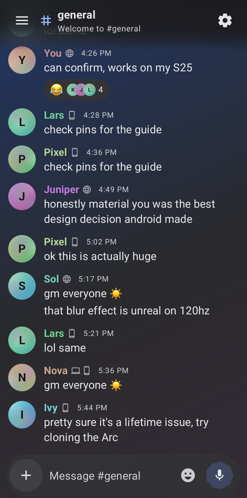
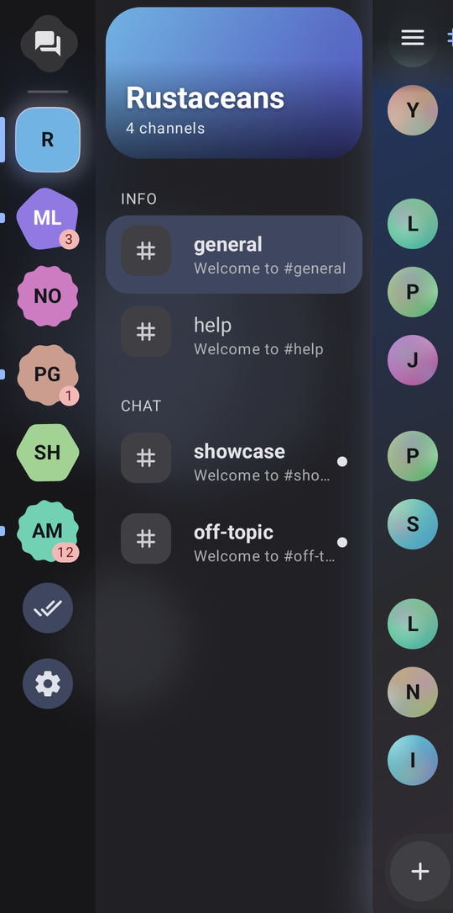
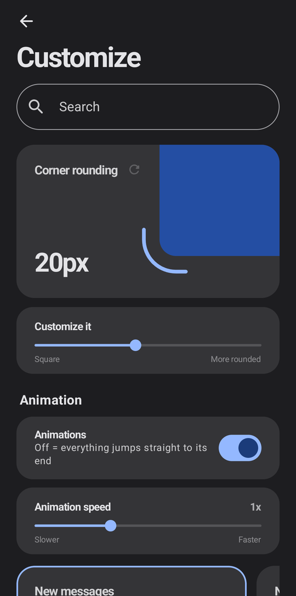
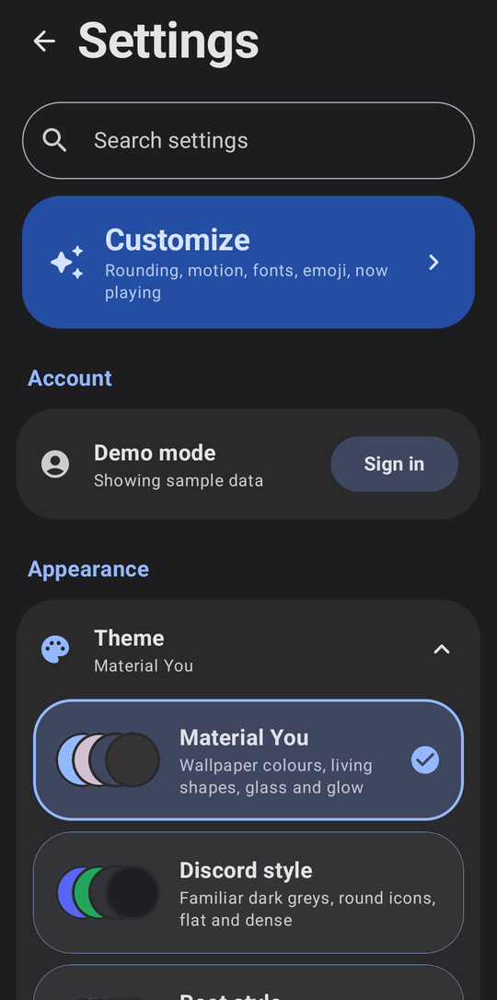

<div align="center">


# Bloom

**A fast, good-looking Android client for [Root](https://rootapp.com) — with plugins, deep customisation and Material You.**

[](https://github.com/vsoultann/bloom/releases/latest)
[](LICENSE)


<sub>Unofficial. Not affiliated with, endorsed by, or supported by Root.</sub>

</div>

<p align="center">
  
  
  
  
</p>

---

## What is it?

Bloom talks to Root's own servers, so you use your normal Root account, servers, DMs and friends. The core (networking, protocol, cache, plugins) is written in **Rust**; the app is **Kotlin + Jetpack Compose**. It starts instantly from a local snapshot and stays live over Root's WebSocket hub.

## Features

**Chat**
- Servers, channels (with Root's channel pictures and descriptions), DMs and group DMs
- Live messages, edits, deletes, typing indicators (with the typers' pictures) and presence
- Replies (including replying to several messages), reactions with any emoji, custom server emoji
- `@mentions` with a picker for people, `@everyone` / `@here` and server roles
- Markdown: **bold**, *italic*, __underline__, ~~strike~~, `||spoilers||`, headings, quotes, code
- Photos, videos (HLS), voice messages, GIFs, files — media keeps its real shape, uploads show progress
- Start-of-chat intros, date dividers, mention highlighting, jump-to-reply

**People**
- Profiles with bios rendered like messages, banners, mutual servers & friends
- Add / accept / decline / remove friends, message and call from a profile
- Long-press anyone for a local **nickname**, per-person **notifications** and **mute** (15 m – forever)
- **Now playing**: share what you're listening to (Spotify, YouTube Music, SoundCloud, …) — only other Bloom users can see it

**Notifications**
- Root's notification centre (mentions, friend requests)
- Android notifications for DMs, mentions, replies, `@everyone` and more — each switchable, with *picture + message*, *message only*, *who pinged you* or *private* styles

**Customise** (page design adapted from [Mochy Music](https://github.com/realidkroo/Mochy-Music))
- Three looks: Material You, Discord-style, Root-style — plus AMOLED black and per-colour overrides
- Corner rounding, animation speed (0.5×–2×) or off, message entrance (rise / blur-in / fade), element blur, frosted glass strength
- Fonts: system, 10 Google Fonts, or import your own TTF/OTF — whole app or messages only, weight and spacing
- Emoji packs: System, Apple, Windows 11 (Fluent), Google, Twitter, Facebook
- Living (morphing) server icons, chat backgrounds, hide status bar
- Runs at your screen's highest refresh rate; steps down automatically in battery saver

**Plugins** (Vencord-style, all optional)
Message Logger · Mutual View · Clear URLs · Text Replace · Message Tags · More Kaomoji · Send Timestamps · Unindent · Silent Typing · No Reply Mention · Friends Since · Platform Indicators · Who Reacted · View Raw · Copy User URLs · Read All Notifications · Pin DMs · Relative Timestamps

**Diagnostics**
- *Settings → Logs & crashes*: failed requests, errors and crash reports, ready to copy or share

## Install

1. Download the latest `Bloom-*.apk` from **[Releases](https://github.com/vsoultann/bloom/releases/latest)**.
2. Open it and allow installing from your browser/file manager.
3. Sign in with your Root account (or tap *Explore with demo data*).

Requires Android 12 or newer, 64-bit ARM (almost every phone from the last few years).

## Privacy

- Your password goes only to Root's own sign-in server. Bloom keeps the session token in its private app storage.
- No analytics, no tracking, no Bloom servers. Logs stay on your phone unless you share them.
- Now playing is stored as invisible characters in *your own* Root status; nothing else leaves your phone.

## Build from source

You need the Android SDK (compileSdk 37) with the NDK, JDK 21, and Rust. On a PC also install
[cargo-ndk](https://github.com/bbqsrc/cargo-ndk) and the target: `cargo install cargo-ndk && rustup target add aarch64-linux-android`.
(On an arm64 phone in Termux, plain `cargo` works.)

```sh
git clone https://github.com/vsoultann/bloom && cd bloom
./gradlew assembleRelease        # builds the Rust core, then the app
# APK: app/build/outputs/apk/release/app-release.apk
```

Release builds are signed with `~/.bloom-signing/keystore.properties` if it exists, otherwise with your debug key.

```
core/   Rust: Root gRPC-web + WebSocket client, cache, emoji, plugins (JNI library)
app/    Kotlin + Compose UI, voice (WebRTC), notifications, media
tools/  scripts used to generate the protocol definitions
```

## Disclaimer

Bloom is an independent, unofficial project. It uses Root's private API, which can change at any time and break things. Using third-party clients may be against Root's terms; use it at your own risk. "Root" is a trademark of its owner; Bloom is not affiliated with it.

## Credits & licences

Bloom is licensed under the **GNU GPL v3.0** (see [LICENSE](LICENSE)).

- [Mochy Music](https://github.com/realidkroo/Mochy-Music) (GPL-3.0) — Customize page design and components
- [gemoji](https://github.com/github/gemoji) (MIT) — emoji names and categories
- [Fluent Emoji](https://github.com/microsoft/fluentui-emoji) (MIT) — Windows 11 emoji pack
- [emoji-datasource](https://github.com/iamcal/emoji-data) (MIT) — Apple / Google / Twitter / Facebook emoji images, loaded at runtime; the artwork belongs to its respective owners
- [Google Fonts](https://github.com/google/fonts) (SIL OFL 1.1) — downloadable fonts
- [Haze](https://github.com/chrisbanes/haze), [Coil](https://github.com/coil-kt/coil), [Media3](https://developer.android.com/media/media3), [stream-webrtc-android](https://github.com/GetStream/webrtc-android) (Apache-2.0)
- Rust crates: prost, serde, tungstenite, ureq, jni and friends (MIT/Apache-2.0)
